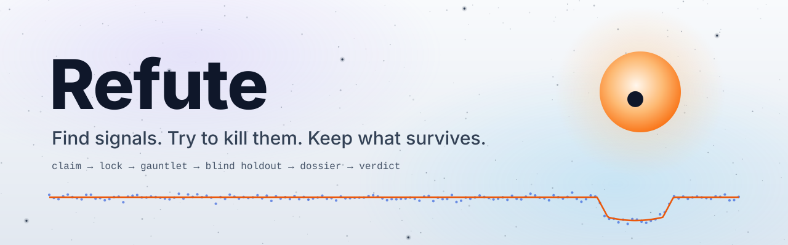

<p align="center">
  <picture>
    <source media="(prefers-color-scheme: dark)" srcset="docs/assets/banner-dark.svg">
    <source media="(prefers-color-scheme: light)" srcset="docs/assets/banner-light.svg">
    
  </picture>
</p>

<p align="center">
  <a href="https://github.com/klucilla/refute/actions/workflows/ci.yml"></a>
  <a href="https://doi.org/10.5281/zenodo.23301000"></a>
  <a href="LICENSE"></a>
  <a href="pyproject.toml"></a>
  <a href="docs/STATUS.md"></a>
</p>

**Refute tries to break a scientific claim before anyone believes it.** An agent may propose a
signal; deterministic, versioned tests attack it, after the claim and its code are locked. Only
what survives is kept, and even that is a candidate, never a discovery.

> [!IMPORTANT]
> **Status, honestly.** No method of Refute is validated (`method_status: not_validated`). The
> current phase and the plan are in [ROADMAP.md](ROADMAP.md).
> - The last phase, v0.5.12, closed on 2026-11-26 **with declared limits** (gate `REFUTED`).
> - The TESS battery's results carry the label 'WEAKENED; does not meet D1, D2, D4, T2a'.
> - The v0.1 and v0.2 self-claims **failed**, and their post-mortems are published.
>
> Every phase, with every failure, is in [docs/STATUS.md](docs/STATUS.md). The plan is in
> [ROADMAP.md](ROADMAP.md).

## The problem it works on today

The TESS satellite produces thousands of transit-like signals: a star dims a little, at regular
intervals. Many are planets. Many others are look-alikes:
- two stars eclipsing each other;
- a neighbouring star leaking into the aperture;
- instrument systematics;
- noise.

Refute's current job is **auditable falsification of TESS transit candidates**:

1. **Claim.** The hypothesis, the targets and the pass/fail criteria are written to `claim.yaml`
   ([spec](docs/claim-spec.md)).
2. **Lock.** The claim, its attachments and the source tree are hashed (SHA-256) before the data
   are read. Any later edit makes `refute verify` return `TAMPERED` ([lock format](docs/lock-format.md)).
3. **Gauntlet.** Deterministic tests try to explain the signal away: odd and even depths, a
   secondary eclipse, centroid shifts, aliases, systematics, red noise.
   - A test that could not have failed says so: zero coverage is `INCONCLUSIVE`, never a pass.
4. **Blind holdout.** A year of data is hidden. The transits are predicted from the other years,
   and the hidden year is read only inside the predicted windows. Every read is logged.
5. **Dossier and verdict.** The dossier holds the data hashes, the plots, the environment and the
   commands to reproduce it. The verdict is one of `SURVIVED`, `WEAKENED`, `REFUTED` and
   `INCONCLUSIVE` ([verdicts](docs/verdicts.md)).

**Agents propose. Deterministic tests decide.** No language-model output is ever a verdict.

## Quick start

To try the released package from [PyPI](https://pypi.org/project/refute/) (Python 3.12 or later):

```bash
pip install refute
refute packs        # the installed domain packs: tess and ml
```

The examples below read claims and dossiers kept in the repository, so they need a clone.

Refute uses [uv](https://docs.astral.sh/uv/) 0.12.24 and Python 3.12 or later; CI tests 3.12 and
3.13. `pyproject.toml` pins that uv version, and any other version exits with an error
([uv settings](https://docs.astral.sh/uv/reference/settings/#required-version), read 2026-11-03).
To install it ([uv installation](https://docs.astral.sh/uv/getting-started/installation/), read
2026-11-03):

```bash
curl -LsSf https://astral.sh/uv/0.12.24/install.sh | sh    # macOS and Linux
```

```powershell
powershell -ExecutionPolicy ByPass -c "irm https://astral.sh/uv/0.12.24/install.ps1 | iex"    # Windows
```

Then, from a clean clone:

```bash
git clone https://github.com/klucilla/refute.git
cd refute
uv sync --frozen                     # install exactly what uv.lock pins
uv run refute packs                  # the installed domain packs: tess and ml
uv run refute verify calibration/v0.5.6/claim.yaml
uv run refute check-dossier calibration/v0.3/main/dossiers/2302.12465/dossier
```

**What you should see:**

- **`refute verify` returns `TAMPERED` (exit code 2) on `main`.** That is the lock doing its job.
  - The claim was locked with the code of tag `v0.5.6-partb-lock`, and the code changed later.
  - The output says that only the code component differs, and names the changed files.
  - At the tag, the same claim returns `PASS`:

    ```bash
    git checkout v0.5.6-partb-lock && uv sync --frozen
    uv run refute verify calibration/v0.5.6/claim.yaml    # PASS (exit code 0)
    git checkout main && uv sync --frozen
    ```

- **`refute check-dossier`** checks a published, sealed dossier against its manifest and seal, and
  ends with `OK: manifest intact`. This dossier comes from the v0.3 paper-replication pack, and it
  is in the repository. The TESS dossiers of v0.4 are on Zenodo
  ([10.5281/zenodo.23898648](https://doi.org/10.5281/zenodo.23898648)), so checking one needs a
  download.
- **The timing.** On a clean local clone, with uv's package cache already filled and no network
  (`UV_OFFLINE=1`), every command above took 20 s in total on 2026-11-26, and the check at the
  tag took 3 s. A first install downloads about 100 packages.
- **The tests:** `uv run pytest`. They use synthetic data only, never the network.
- **Every command** is documented in [docs/cli.md](docs/cli.md).

## What Refute is, and what it is not

| Refute is | Refute is not |
|---|---|
| A **falsification engine**: it attacks a claim instead of confirming it. | A discovery machine. It produces candidates and verdicts, never confirmed discoveries. |
| **Pre-registration with teeth**: the claim, its targets and the code are hashed before any hidden data is seen. Any later edit is `TAMPERED`. | An AI oracle. No language-model output ever decides a verdict. |
| **Reproducible**: every verdict ships in a dossier with data hashes, plots, the environment and the commands to rerun it. | A submission bot. Refute never submits anything to a scientific body; any submission is made by a human. |
| **Domain-agnostic**: the engine knows no science; domain packs do. | A judge of people. Verdicts are about claims, never about their authors. |
| **Honest about its limits**: a failed self-claim is published, not tuned away. | Validated. Every result so far is labelled `method_status: not_validated`. |

The verdicts for paper claims are `REPRODUCED`, `FRAGILE`, `NOT_REPRODUCED`, `NOT_REPRODUCIBLE` and
`INCONCLUSIVE`. There is no `TRUE`.

## Horizon

These are plans, and none of them exists yet. The order and the rules are in
[ROADMAP.md](ROADMAP.md).

- **Other domains.** The engine knows no science; a domain pack brings the data, the attacks and
  the holdout. The planned packs:
  - variable stars in TESS data;
  - mathematics, by counterexample search with verifiable certificates;
  - in time, any field with public data and falsifiable claims, through a pack SDK.
- **Refute@Home.** Volunteer computing, in the tradition of SETI@home and Einstein@Home. Each work
  unit would be computed by two independent workers whose results must agree. It is meant for
  people who never open a terminal.

## How AI is used here

- **AI agents** write code, tests and documents, and run checks, in sessions the maintainer
  approves. Commits written with an agent say so in a `Co-Authored-By` trailer.
- **Reviews:** fresh, read-only agent sessions review dossiers and phase gates. A second model
  family (Codex) reviews plans.
- **What agents never do:**
  - decide a verdict;
  - send a message to a paper's authors;
  - submit anything to a scientific body.

The full text is in [docs/STATUS.md](docs/STATUS.md), part 2.

## Contributing, conduct and citation

- **Attacks on Refute itself** are as welcome as features: lock bypasses, holdout leaks, verdicts
  that should not survive. Open an issue, or report security problems privately
  ([SECURITY.md](SECURITY.md)).
- Start with [CONTRIBUTING.md](CONTRIBUTING.md). Community participation follows the
  [Contributor Covenant](CODE_OF_CONDUCT.md).
- **Verdicts are about claims, never about authors.** A negative result on a paper is published
  only after a right-of-reply period. Medical or diagnostic claims and dual-use biology or
  chemistry are out of scope.
- **To cite Refute,** see [CITATION.cff](CITATION.cff) and the concept DOI
  [10.5281/zenodo.23301000](https://doi.org/10.5281/zenodo.23301000).
- **Data and acknowledgments,** with the licence of each source and where each statement comes
  from: [docs/STATUS.md](docs/STATUS.md), part 2, "Data and acknowledgments".

## License

Apache-2.0 ([LICENSE](LICENSE)).

<!-- The v0.1 calibration tool (calibration/update_readme.py) writes between these markers. -->
<!-- CALIBRATION:START -->
<!-- CALIBRATION:END -->
